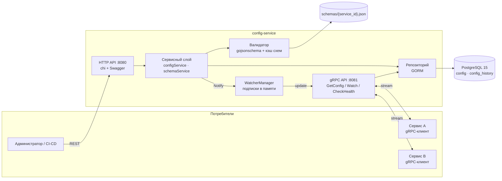
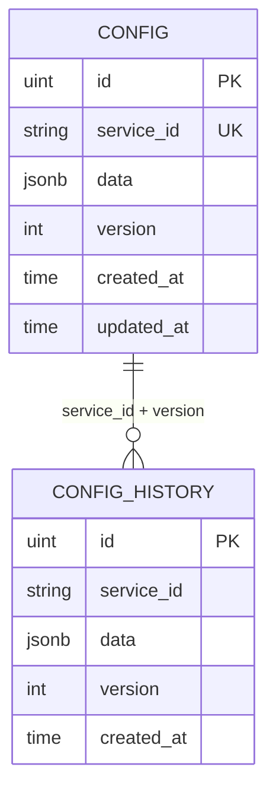
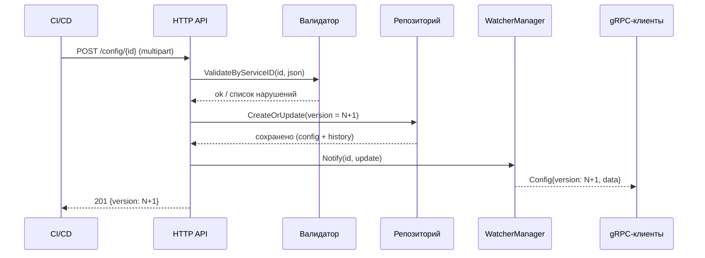

# config-service

**Сервис централизованного управления конфигурациями распределённых систем.**
Хранит конфигурации всех сервисов в одном месте, версионирует каждое изменение,
валидирует его по JSON-схеме и доставляет подписчикам за миллисекунды через gRPC-стрим.


---

**Содержание**

- [Зачем это нужно](#зачем-это-нужно)
- [Возможности](#возможности)
- [Архитектура](#архитектура)
- [Быстрый старт](#быстрый-старт)
- [Конфигурация](#конфигурация)
- [HTTP API](#http-api)
- [gRPC API](#grpc-api)
- [Модель данных](#модель-данных)
- [Как это работает внутри](#как-это-работает-внутри)
- [Структура проекта](#структура-проекта)
- [Разработка](#разработка)
- [Ограничения](#ограничения)
- [Планы](#планы)

---

## Зачем это нужно

В микросервисной системе у каждого сервиса десятки параметров: адреса БД, таймауты,
пороги circuit breaker'ов, фичефлаги, ключи внешних API. Если держать их в файлах и
переменных окружения на каждом узле, получается знакомая картина:

- изменение надо руками раскатать по всем экземплярам — и где-то оно обязательно
  не доедет;
- ошибку в конфиге невозможно откатить: предыдущее значение никто не сохранял;
- нет валидации: опечатка в имени поля выясняется уже в проде;
- чтобы применить настройку, нужен рестарт сервиса.

`config-service` решает это как отдельный инфраструктурный компонент:

| Проблема | Решение |
|---|---|
| Рассинхронизация экземпляров | единая точка хранения + push-уведомления по gRPC |
| Ошибки в конфигурации | валидация по JSON-схеме до сохранения |
| Невозможность откатиться | полная история версий и откат к любой из них |
| Рестарт ради настройки | клиент получает обновление в уже открытом стриме |

---

## Возможности

- **Два интерфейса.** HTTP REST — для администратора и CI/CD (загрузка схем, публикация,
  история, откат). gRPC — для сервисов-клиентов (получение конфига и подписка на
  изменения).
- **Версионирование.** Версия монотонно растёт при каждой публикации; история
  append-only, старые записи не перезаписываются.
- **Откат.** `POST /config/{service}/3/rollback` создаёт **новую** версию с данными
  версии 3 — история остаётся линейной, «машина времени» не ломается.
- **Валидация по JSON Schema.** Для каждого сервиса загружается свой шаблон
  (`gojsonschema`): типы, обязательные поля, длины строк, диапазоны чисел, regex,
  вложенные объекты.
- **Push-доставка.** `WatcherManager` держит подписки в памяти, рассылает обновления
  неблокирующе (таймаут 1 с на подписчика, буфер 10 сообщений).
- **Heartbeat.** Каждые 30 секунд в стрим уходит служебное сообщение (`version = 0`) —
  клиент замечает разрыв соединения и переподключается.
- **Восстановление после сбоя.** После переподключения клиент сразу получает
  актуальную версию, даже если пропустил несколько обновлений.
- **Эксплуатация.** Health-check (`CheckHealth` + стандартный gRPC health), reflection,
  Swagger UI, файловые логи, graceful shutdown по SIGINT/SIGTERM.

---

## Архитектура



Ключевая идея: **HTTP — плоскость управления** (кто и что меняет), **gRPC — плоскость
данных** (кто и когда получает изменения). Обе плоскости работают с одним репозиторием,
поэтому публикация по HTTP немедленно видна в gRPC-стримах.

| Компонент | Расположение | Ответственность |
|---|---|---|
| HTTP API | `internal/api/http` | маршруты chi, middleware, обработчики, Swagger |
| gRPC API | `internal/api/grpc` | сервер, интерсепторы, `GetConfig`, `Watch`, health, reflection |
| Бизнес-логика | `internal/service` | публикация, чтение, откат, работа со схемами |
| Валидатор | `internal/core/validator` | загрузка схем, кэш под `RWMutex`, валидация документа |
| Репозиторий | `internal/repo` | транзакции, upsert, история, откат, удаление |
| Нотификации | `internal/watcher` | `Subscribe`, `Notify`, `Stop`, буферизированные каналы |
| Модели | `internal/models` | `Config`, `ConfigHistory` (GORM) |
| Сборка приложения | `internal/app` | инициализация зависимостей и жизненный цикл серверов |

---

## Быстрый старт

### Docker (рекомендуется)

Нужны Docker 20.10+ и Docker Compose 2.0+.

```bash
git clone https://github.com/Delorency/config-service.git
cd config-service

make dockerup
# эквивалент:
# docker compose --env-file=./configs/.env --env-file=./configs/.docker_env up -d
```

Поднимаются два контейнера: `db` (PostgreSQL 15, volume `postgres_data`) и `app`
(HTTP `:8080`, gRPC `:8081`, БД снаружи на `:9388`).

```bash
docker compose down     # остановить
docker compose logs -f app
```

### Локально

Нужны Go 1.26+ и PostgreSQL 13+.

```bash
createdb configservice

# при необходимости поправьте configs/.env (DB_ROLE, DB_PASS, DB_NAME, DB_HOST, DB_PORT)
go run ./cmd/server/main.go     # или make terminalup
```

> Запускать нужно **из корня репозитория**: конфиг читается из `./configs/.env`.
> Миграции применяются автоматически при старте.

### Проверка

| Что | Адрес |
|---|---|
| HTTP API | http://localhost:8080 |
| Swagger UI | http://localhost:8080/swagger/index.html |
| gRPC | localhost:8081 |
| Демо-клиент | `go run ./cmd/client/main.go` |

---

## Конфигурация

Все настройки — через переменные окружения из `configs/.env` (локально) и
`configs/.docker_env` (переопределения для контейнеров).

```env
# HTTP
HTTPHOST=0.0.0.0
HTTPPORT=8080
HTTPSHUTDOWNTIMEOUT=30s

# gRPC
GRPCHOST=0.0.0.0
GRPCPORT=8081
GRPCSHUTDOWNTIMEOUT=30s

# PostgreSQL
DB_ROLE=delorency
DB_PASS=delorency
DB_HOST=localhost
DB_PORT=5432
DB_NAME=configservice

# Логи
LOGSDIR=logs/
APILOGFILENAME=api.log
GRPCLOGFILENAME=grpc.log
DBLOGFILENAME=db.log

# Схемы
SCHEMASDIR=schemas/
```

| Переменная | По умолчанию | Назначение |
|---|---|---|
| `HTTPHOST` / `HTTPPORT` | `localhost` / `8080` | адрес HTTP-сервера |
| `HTTPSHUTDOWNTIMEOUT` | `30s` | таймаут graceful shutdown HTTP |
| `GRPCHOST` / `GRPCPORT` | `localhost` / `8081` | адрес gRPC-сервера |
| `GRPCSHUTDOWNTIMEOUT` | `30s` | таймаут graceful shutdown gRPC |
| `DB_ROLE`, `DB_PASS`, `DB_NAME`, `DB_HOST`, `DB_PORT` | — | подключение к PostgreSQL |
| `LOGSDIR`, `APILOGFILENAME`, `GRPCLOGFILENAME`, `DBLOGFILENAME` | `logs/`, `api.log`, `grpc.log`, `db.log` | файловые логи |
| `SCHEMASDIR` | `schemas/` | каталог JSON-схем |

---

## HTTP API

Базовый URL `http://localhost:8080`. Тело ошибок — `{"error": "<текст>"}`.

| Метод | Путь | Назначение | Успех |
|---|---|---|---|
| `POST` | `/schema/{service_id}/upload` | загрузить JSON-схему (multipart, поле `schema`, ≤ 1 МБ) | `201` |
| `GET` | `/schema/{service_id}` | получить схему | `200` |
| `DELETE` | `/schema/{service_id}` | удалить схему **и все конфиги сервиса** | `200` |
| `POST` | `/config/{service_id}` | опубликовать новую версию (multipart, поле `config`, ≤ 5 МБ) | `201` |
| `GET` | `/config/{service_id}` | список версий (`limit` 1..100, `offset`) | `200` |
| `GET` | `/config/{service_id}/actual` | актуальная версия | `200` |
| `GET` | `/config/{service_id}/{version}` | конкретная версия из истории | `200` |
| `POST` | `/config/{service_id}/{version}/rollback` | откат к версии (создаёт новую) | `200` |

### Полный сценарий

**1. Схема сервиса** — `auth-service.json`:

```json
{
  "$schema": "http://json-schema.org/draft-07/schema#",
  "type": "object",
  "required": ["database", "server"],
  "properties": {
    "database": {
      "type": "object",
      "required": ["host", "port"],
      "properties": {
        "host": { "type": "string", "minLength": 1 },
        "port": { "type": "integer", "minimum": 1, "maximum": 65535 }
      }
    },
    "server": {
      "type": "object",
      "properties": {
        "timeout": { "type": "string", "pattern": "^[0-9]+(ms|s)$" }
      }
    }
  }
}
```

```bash
curl -X POST http://localhost:8080/schema/auth-service/upload \
     -F "schema=@auth-service.json"
# 201 {"service_id":"auth-service","filename":"auth-service.json","message":"schema uploaded successfully"}
```

**2. Публикация конфигурации** — `config.json`:

```json
{
  "database": { "host": "postgres", "port": 5432 },
  "server":   { "timeout": "2s" }
}
```

```bash
curl -X POST http://localhost:8080/config/auth-service -F "config=@config.json"
# 201 {"service_id":"auth-service","version":1,"filename":"config.json","created_at":"...","message":"config created successfully"}

# правим config.json (например, timeout: "5s") и публикуем ещё раз
curl -X POST http://localhost:8080/config/auth-service -F "config=@config.json"
# 201 {"service_id":"auth-service","version":2,...}
```

**3. Чтение и история**

```bash
curl http://localhost:8080/config/auth-service/actual
# {"service_id":"auth-service","version":2,"data":{...},"created_at":"...","updated_at":"..."}

curl "http://localhost:8080/config/auth-service?limit=10&offset=0"
# {"service_id":"auth-service","items":[{"ID":2,"ServiceID":"auth-service","Data":{...},"Version":2,"CreatedAt":"..."},
#  {"ID":1,...}],"total":2,"limit":10,"offset":0}

curl http://localhost:8080/config/auth-service/1
# {"ID":1,"ServiceID":"auth-service","Data":{...},"Version":1,"CreatedAt":"..."}
```

> В ответах списка версий и конкретной версии ключи приходят в PascalCase: обработчики
> отдают GORM-модель напрямую, без `json`-тегов. Остальные эндпоинты возвращают
> snake_case-структуры. Если нужен единый стиль — добавьте теги в `internal/models`.

**4. Откат**

Возвращаемся к версии 1, когда актуальна версия 2: создаётся версия 3 с данными версии 1.

```bash
curl -X POST http://localhost:8080/config/auth-service/1/rollback
# {"service_id":"auth-service","version":3,"target_version":1,"message":"successfully rolled back","rolled_back_at":"..."}
```

**5. Удаление схемы вместе с конфигами**

```bash
curl -X DELETE http://localhost:8080/schema/auth-service
# {"service_id":"auth-service","message":"schema deleted"}
```

### Статусы ошибок

| Код | Когда |
|---|---|
| `400` | нет `service_id`; файл больше лимита; невалидный JSON; ошибка валидации по схеме; некорректный номер версии; откат на текущую версию |
| `404` | нет схемы; нет конфигурации; нет указанной версии |
| `500` | внутренняя ошибка |

Актуальный контракт с примерами — в Swagger UI (`/swagger/index.html`).

---

## gRPC API

```proto
syntax = "proto3";
package config;
option go_package = "main/api/proto";

service ConfigService {
  rpc GetConfig   (GetRequest)   returns (Config);
  rpc Watch       (WatchRequest) returns (stream Config);
  rpc CheckHealth (HealthRequest) returns (HealthResponse);
}

message GetRequest   { string service_id = 1; }
message WatchRequest { string service_id = 1; int32 current_version = 2; }
message Config       { string service_id = 1; bytes data = 2; int32 version = 3; }
message HealthRequest  {}
message HealthResponse { string status = 1; }
```

`Config.data` — «сырой» JSON в байтах: сервер не навязывает клиенту модель данных.

```bash
# health
grpcurl -plaintext localhost:8081 config.ConfigService/CheckHealth

# актуальная версия
grpcurl -plaintext -d '{"service_id":"auth-service"}' \
        localhost:8081 config.ConfigService/GetConfig

# подписка на обновления (current_version = 0 — получить всё, начиная с текущего)
grpcurl -plaintext -d '{"service_id":"auth-service","current_version":0}' \
        localhost:8081 config.ConfigService/Watch
```

Семантика `Watch`:

1. Сервер подписывает клиента и, если `current_version` меньше актуальной, **сразу
   отправляет актуальную версию**.
2. Далее в стрим приходят обновления при каждой публикации/откате.
3. Каждые 30 секунд приходит heartbeat — сообщение `Config` с `version = 0`.
4. При разрыве соединения подписка удаляется (`defer`), клиент переподключается и снова
   получает актуальную версию.

Ошибки: `InvalidArgument` (пустой `service_id`), `NotFound` (конфигурации нет),
`Internal`, `Canceled`/`Unavailable` при обрыве стрима.

---

## Модель данных



- `config` — **одна строка на сервис** (уникальный индекс по `service_id`), всегда
  актуальная версия. Быстрое чтение — один запрос.
- `config_history` — **append-only** история: каждая публикация и каждый откат
  добавляют запись.
- `data` — тип `jsonb`: произвольная структура, индексируемые вложенные поля.

Публикация версии `N` и откат выполняются в транзакции: обновление `config` + вставка
в `config_history` атомарны (сервис не может остаться без истории).

Подробное описание схемы — в отчёте по практике; в коде модели лежат в
`internal/models/models.go`.

---

## Как это работает внутри

**Публикация конфигурации**



**Валидатор.** Схемы читаются с диска один раз и кэшируются в `map[string]JSONLoader`
под `sync.RWMutex`; повторные проверки не трогают файловую систему. При загрузке схемы
проверяется, что это валидный JSON и что в корне есть `"type"` (иначе документ не
сможет быть JSON-схемой).

**Рассылка.** `Notify` работает по копии списка подписчиков, поэтому не держит
блокировку во время отправки. Подписчик, который не успел принять сообщение за 1 с,
пропускается с записью в лог — один медленный клиент не тормозит остальных. Устаревшие
обновления (версия ≤ уже полученной) не отправляются.

**Откат.** Проверяется наличие схемы → целевая версия достаётся из истории → повторно
валидируется по **текущей** схеме (старый конфиг должен быть валиден и сегодня) →
создаётся версия `current + 1` с данными целевой → уведомление подписчикам.

---

## Структура проекта

```text
.
├── api/proto/                  # config.proto + сгенерированный код
├── cmd/
│   ├── client/main.go          # демонстрационный gRPC-клиент
│   └── server/main.go          # точка входа
├── configs/
│   ├── .env                    # локальная конфигурация
│   └── .docker_env             # переменные для docker compose
├── docs/                       # сгенерированный Swagger (json/yaml/go)
├── internal/
│   ├── app/                    # сборка и запуск приложения
│   ├── api/
│   │   ├── grpc/               # server, get, watch, интерсепторы
│   │   └── http/               # router, server, handlers/{config,schema}Handler
│   ├── config/                 # чтение .env через cleanenv
│   ├── core/validator/         # валидация по JSON-схемам
│   ├── logger/                 # три логгера (api, grpc, db)
│   ├── models/                 # GORM-модели
│   ├── repo/                   # доступ к PostgreSQL
│   ├── service/                # configService, schemaService
│   ├── utils/                  # вспомогательные функции
│   └── watcher/                # WatcherManager: subscribe, notify
├── logs/                       # файлы логов
├── schemas/                    # загруженные JSON-схемы
├── storage/                    # подключение к БД и миграции
├── Dockerfile
├── docker-compose.yml
├── Makefile
└── go.mod
```

---

## Разработка

```bash
make dockerup      # поднять всё в Docker
make terminalup    # запустить локально: go run ./cmd/server/main.go

go build ./...
go vet ./...

# перегенерация Swagger после изменения аннотаций
swag init -g cmd/server/main.go
```

Логи пишутся в `logs/api.log`, `logs/grpc.log`, `logs/db.log`. Схемы — в `schemas/`.
Оба каталога создаются автоматически.

---

## Ограничения

Проект учебный, поэтому часть вещей сознательно не реализована — это честный список
того, чего ждать не стоит:

- **Нет аутентификации и TLS.** Любой, кто достучался до порта, может опубликовать
  конфигурацию. Планируется JWT + TLS.
- **Один экземпляр.** Подписки живут в памяти процесса: при нескольких репликах клиент,
  подключённый к реплике A, не узнает о публикации через реплику B.
- **Схемы на локальной ФС.** `schemas/` не шарится между контейнерами; для нескольких
  реплик нужен общий том или перенос схем в БД.
- **Нет оптимистической блокировки версии.** Две одновременные публикации могут
  вычислить одинаковый `nextVersion`; уникального индекса `(service_id, version)` в
  истории нет.
- **Загрузка схем — только `.json`** (хотя Swagger-аннотация упоминает YAML).
- **Нет метрик и трассировки.** Логи файловые, Prometheus/OpenTelemetry не подключены.
- **Коды ошибок упрощены:** откат возвращает `400` на любую ошибку, включая «уже на
  этой версии», хотя Swagger документирует `409`.
- **Разнобой в JSON-ключах:** список версий и конкретная версия отдаются GORM-моделями
  без `json`-тегов (`ID`, `ServiceID`, `Data`, `Version`, `CreatedAt`), остальные
  эндпоинты — в snake_case. Лечится тегами в `internal/models/models.go`.

## Планы

- [ ] JWT-аутентификация и TLS для HTTP и gRPC
- [ ] Несколько окружений: `dev` / `staging` / `production`
- [ ] Хранение схем в PostgreSQL и версионирование самих схем
- [ ] Оптимистическая блокировка версий (ETag / `If-Match`)
- [ ] Метрики Prometheus и трассировка OpenTelemetry
- [ ] Готовые клиентские SDK (Go, TypeScript, Python)
- [ ] Helm-чарт и горизонтальное масштабирование (pub/sub между репликами)

---

<p align="center">
  <sub>Учебный проект по дисциплине «Проектирование и разработка сервиса централизованного управления конфигурациями распределённых систем» · СПбПУ, ИКНТ</sub>
</p>
